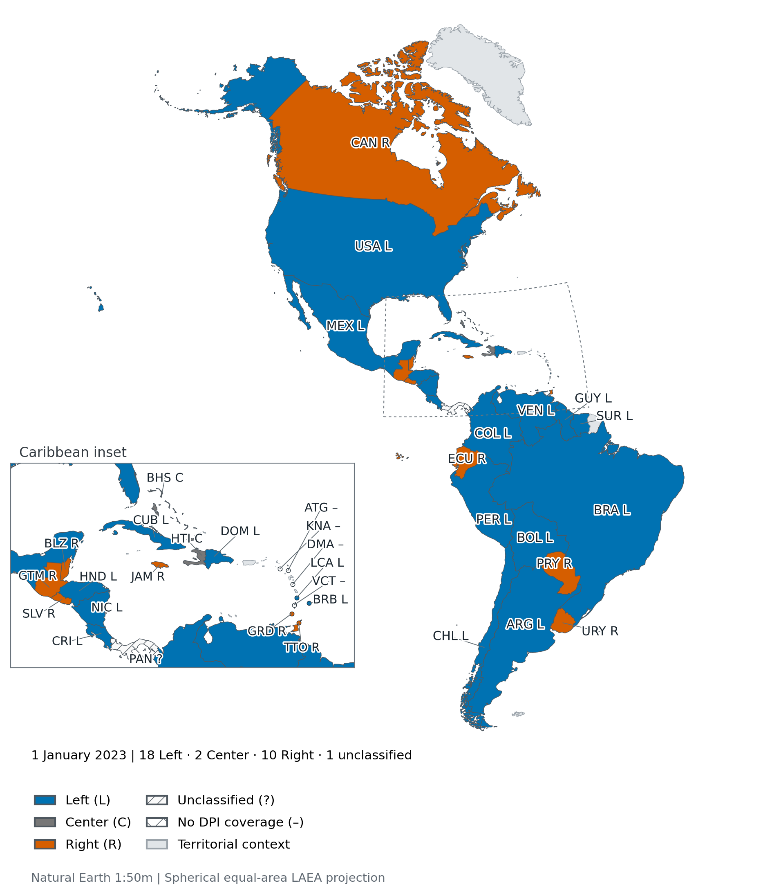
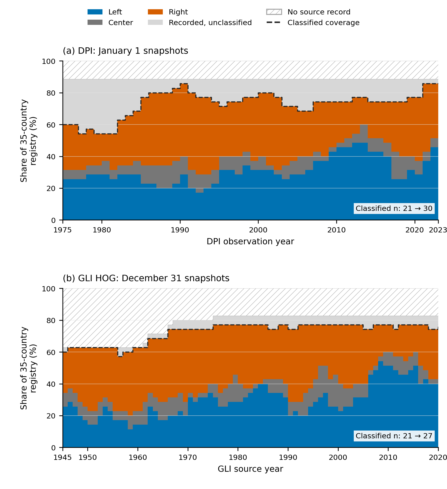
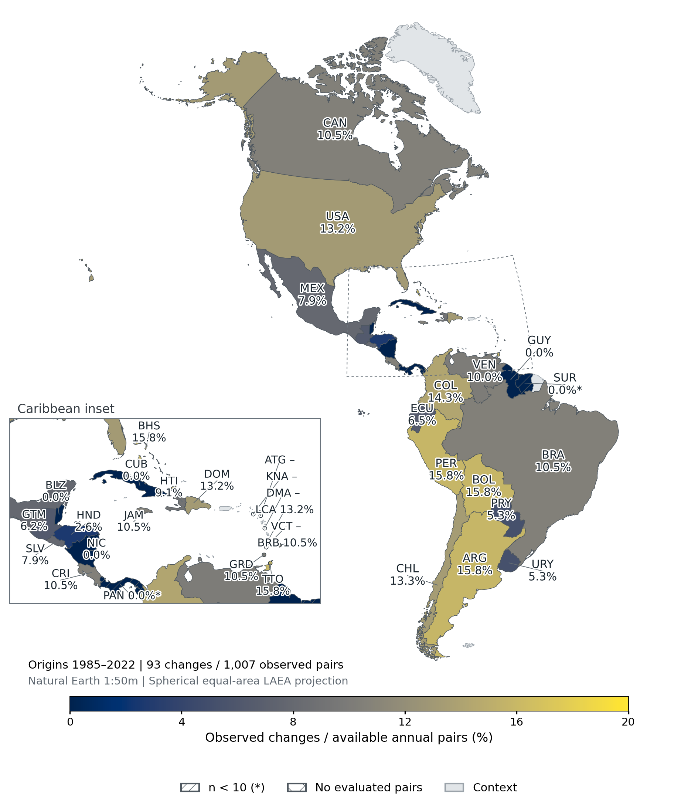
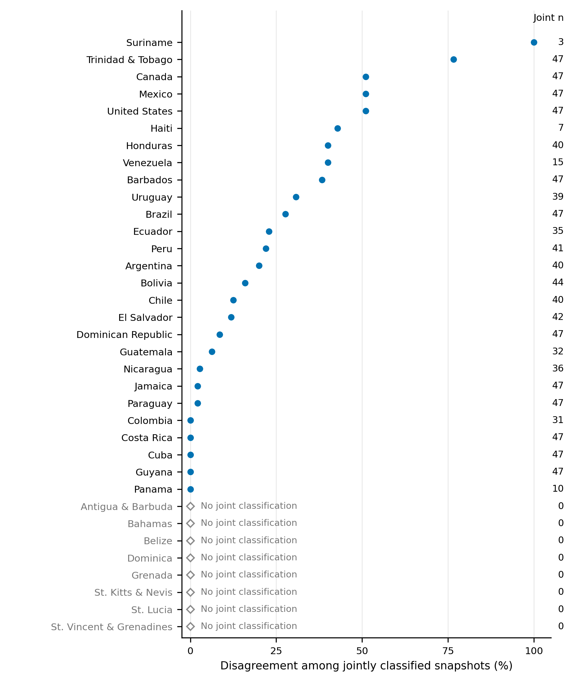
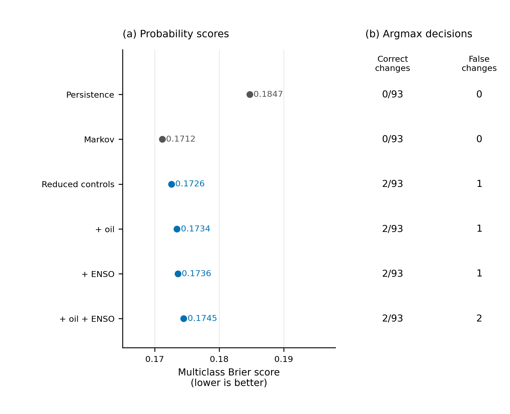
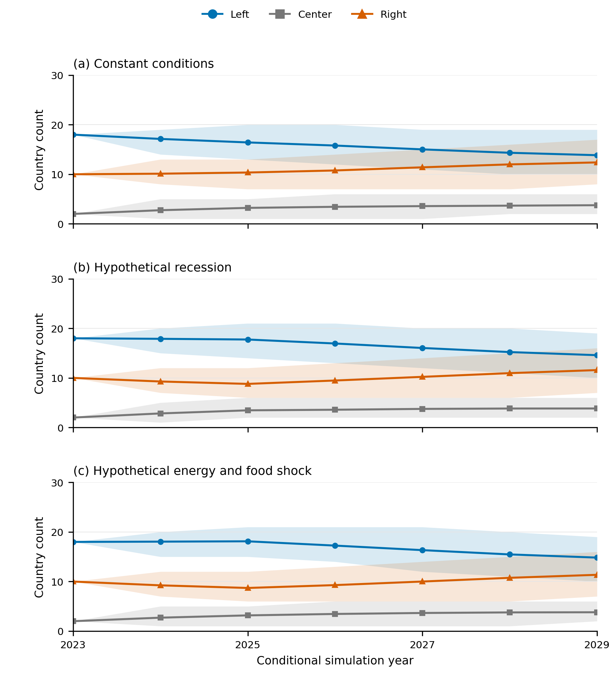
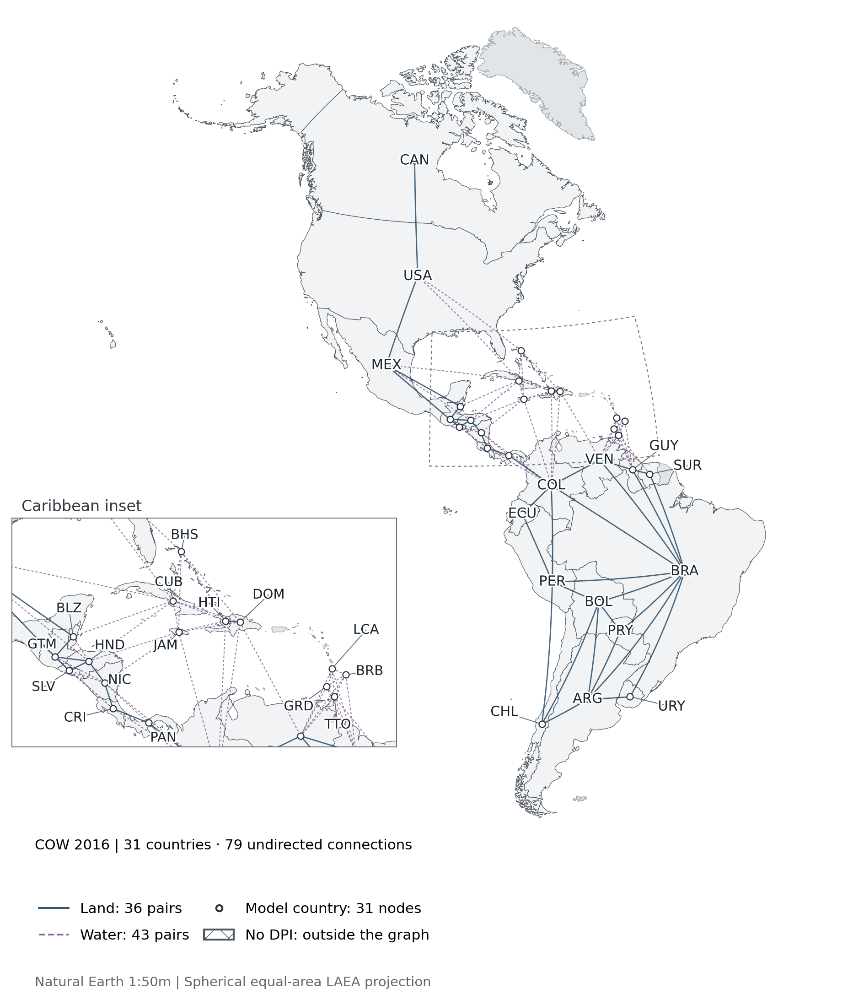
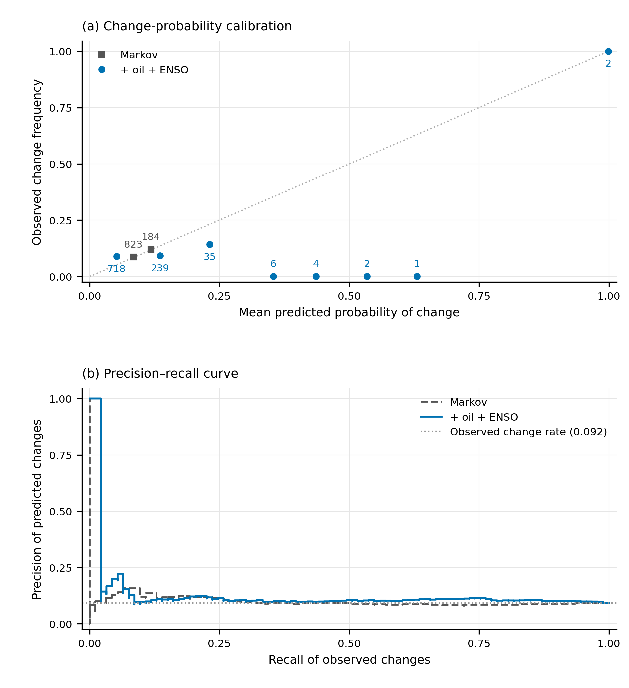
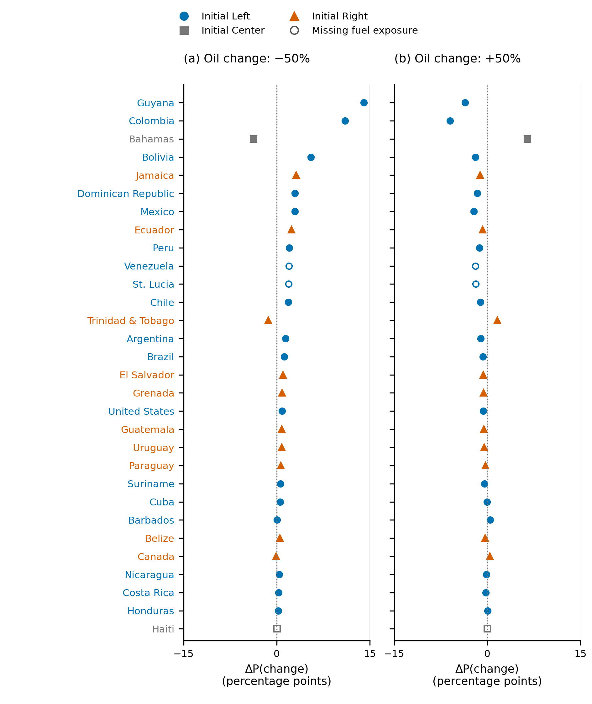

# English figure and table outputs

Observed data end in January 2023 (DPI) and December 2020 (GLI).
All captions distinguish observed evidence from conditional simulations.

## Figures

### Figure 01. Executive-party economic orientation on 1 January 2023

Figure 1. DPI classification on 1 January 2023 for all 35 sovereign countries in the Americas: 18 Left (L), 2 Center (C), 10 Right (R), 1 unclassified (?) and 4 without DPI coverage (–). Panama has an observation but no ideological classification. Dependent territories are neutral context. Caribbean circles locate eight small countries; marker size does not encode population or area. Source map units are preserved, including two units for Antigua and Barbuda sharing one national observation. The map shows the source's executive-party coding at the stated date. Canada is shown as Right because that is its DPI classification on 1 January 2023; source coding is preserved. Natural Earth v5.1.1 provides a generalized base map, not annual boundary reconstructions.

Source: DPI 2023; Natural Earth Admin 0 Map Units 1:50m, layer v5.1.1, repository release v5.1.2.

[Vector SVG](Figure_01_master.svg) · [Vector PDF](Figure_01_master.pdf)

### Figure 02. Annual ideology composition and source coverage in the Americas

State counts are divided by a fixed registry of 35 current sovereign American countries. DPI records snapshots on 1 January of each year from 1975 to 2023; GLI records head-of-government snapshots on 31 December of each year from 1945 to 2020. The dashed boundary marks the classified share; grey and hatched regions distinguish recorded but unclassified states from absent source records. Historical absence may reflect state-system entry or source coverage. No ideology imputation, date pooling, role fallback or interpolation of missing observations is used.

Source: Cached DPI 2023 source and frozen outputs/history/gli_hog_aligned_panel.csv; actual source dates are retained.

[Vector SVG](Figure_02_master.svg) · [Vector PDF](Figure_02_master.pdf)

### Figure 03. Observed ideological-transition frequency, origins 1985–2022

Figure 3. Observed annual changes in DPI class as a percentage of each country's available evaluated transitions: 93 changes across 1007 unique country-origin pairs, origins 1985–2022 and target years 1986–2023. The calculation uses the Markov model's evaluation rows once, without pooling models; values are observed change frequencies, not predicted probabilities or forecasting accuracy. Country denominators are provided in Figure_03_data.csv. Hatching and an asterisk indicate fewer than ten observed pairs: PAN 0/8; SUR 0/3. Cross-hatching marks no available evaluated pairs; dependent territories are neutral context. Coverage marks are descriptive, not tests of significance. Natural Earth v5.1.1 provides a generalized base map; the origin-year range does not indicate reconstructed historical boundaries.

Source: outputs/extensions/dpi_drivers/predictions.csv, model=markov; Natural Earth Admin 0 Map Units v5.1.1.

[Vector SVG](Figure_03_master.svg) · [Vector PDF](Figure_03_master.pdf)

### Figure 04. DPI–GLI disagreement by country

Rates use only jointly classified country-years, with country denominators in the right-hand column. The primary HOG comparison contains 230 disagreements among 1019 joint observations (22.6%). DPI snapshots on 1 January of year y are compared with GLI snapshots on 31 December of year y−1, for aligned years 1975–2021. Open diamonds flag countries with no joint classification; their rates are undefined, not zero. GLI used DPI among its coding sources, so this comparison is a measurement audit rather than independent validation. No confidence intervals or ranking uncertainty are estimated.

Source: Frozen outputs/history/dpi_gli_hog_comparison_by_country.csv and history_report.json; HOG is the primary role.

[Vector SVG](Figure_04_master.svg) · [Vector PDF](Figure_04_master.pdf)

### Figure 05. Probability scores and recovery of observed ideological changes

The extended DPI evaluation covers origins 1985–2022: 1007 country-year pairs and 93 observed changes. Panel (a) reproduces the frozen multiclass Brier scores for six models; the displayed score axis is restricted to 0.165–0.198. Panel (b) counts correct destination states among observed changes and predicted changes among actually unchanged pairs, using stored argmax decisions. Markov recovers 0/93 changes; reduced controls recover 2/93, with 1 false change prediction. All six models recover 0/60 changes for origins 2000–2022. Regression labels add oil and/or ENSO to the same reduced controls. No new fitting or inferential intervals are used.

Source: Frozen outputs/extensions/dpi_drivers/metrics.csv and predictions.csv; all comparisons use stored chronological predictions.

[Vector SVG](Figure_05_master.svg) · [Vector PDF](Figure_05_master.pdf)

### Figure 06. Conditional Monte Carlo paths under three hypothetical scenarios

The original main-model simulation starts from 30 classified countries in January 2023 and uses 500 paths through 2029. Lines show mean country counts; shaded regions show the 5th–95th percentiles across simulated paths. The initial state composition is identical across scenarios. Conditions are fixed according to the stored constant, recession, or energy-and-food scenario; annual updates are synchronous. These bands describe conditional path variation, excluding parameter uncertainty. They are neither confidence intervals nor forecasts of realized governments, and no causal interpretation is assigned to scenario contrasts.

Source: Frozen outputs/main/escenarios_resumen.csv; original simulation outputs are used without rerunning paths or fitting parameters.

[Vector SVG](Figure_06_master.svg) · [Vector PDF](Figure_06_master.pdf)

### Supplement 01. Geographic model connections in the 2016 COW snapshot

Supplementary Figure 1. COW Direct Contiguity v3.2 supplies 79 unique undirected pairs among 31 DPI-covered countries: 36 land connections (solid) and 43 water connections (dashed). All source water-distance categories up to 400 miles are included; links represent contiguity categories, not displayed line length. Natural Earth label points locate nodes and are not capitals. One great-circle link is drawn per pair without arrows; equal line widths within each type do not encode intensity. The source ends in 2016: historical evaluation uses min(t−1, 2016), and later graphs carry forward that snapshot. Connectivity is a model exposure assumption and does not establish causal diffusion. Countries without DPI coverage are outside this graph; territories remain neutral context. Natural Earth v5.1.1 provides a generalized base map, not a reconstruction of 2016 boundaries.

Source: COW Direct Contiguity v3.2, 2016 snapshot; Natural Earth Admin 0 Map Units v5.1.1.

[Vector SVG](Supplement_01_master.svg) · [Vector PDF](Supplement_01_master.pdf)

### Supplement 02. Calibration and ranking of change probabilities

Markov and reduced controls + oil + ENSO use the same frozen extended evaluation: 1007 country-year pairs and 93 observed changes, origins 1985–2022. Panel (a) uses 10 equal-width probability bins. Only nonempty bins are drawn, and labels give each bin's observation count; empty bins remain n=0 with undefined frequencies in the accompanying data. The dotted diagonal denotes perfect calibration. Panel (b) shows descriptive precision–recall curves from all stored probabilities; the horizontal line is the observed change rate. There are no naive independent-observation confidence intervals, new thresholds chosen for reporting, model refits or causal claims.

Source: Frozen outputs/extensions/dpi_drivers/predictions.csv; descriptive bin summaries and precision–recall coordinates only.

[Vector SVG](Supplement_02_master.svg) · [Vector PDF](Supplement_02_master.pdf)

### Supplement 03. Conditional one-step oil contrasts by country

The frozen reduced-controls + oil model changes only the hypothetical oil-price growth input to −50% or +50%, relative to a stored 0% reference, holding all other covariates at their stored origin-2023 values and the initial ideological states at their 1 January 2023 observations. Dots show the change in probability of leaving the initial state, in percentage points, for 30 classified countries. Colors and marker shapes identify initial Left, Center or Right states; countries are ordered by their largest absolute displayed contrast. Open markers identify missing fuel-exposure inputs (Haiti, St. Lucia, Venezuela); the model's stored probabilities use its training-time imputation and missingness indicators, not observed replacement exposures. Import and export shares have different denominators and are not net petroleum exposure. These are one-step conditional model contrasts, without parameter intervals, realized future outcomes or causal interpretation.

Source: Frozen outputs/extensions/dpi_drivers/conditional_oil_scenarios.csv; lean_oil probabilities, fixed national exposure year 2021 and origin 2023.

[Vector SVG](Supplement_03_master.svg) · [Vector PDF](Supplement_03_master.pdf)

## Tables

- [Table 01: Source coverage and measurement units](tables/Table_01_source_coverage.md)
- [Table 02: Observed DPI classification on January 1, 2023](tables/Table_02_dpi_membership_2023.md)
- [Table 03: DPI–GLI disagreement after date alignment](tables/Table_03_aligned_source_disagreement.md)
- [Table 04: DPI driver-extension performance under chronological evaluation](tables/Table_04_dpi_model_performance.md)
- [Table 05: GLI head-of-government historical-panel performance](tables/Table_05_gli_hog_model_performance.md)
- [Table 06: Driver definitions, time alignment and interpretation](tables/Table_06_driver_definitions.md)
